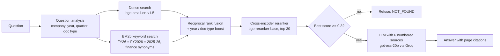

# FinSight: question answering over Indian annual reports

Ask a question about six Indian companies (TCS, Infosys, Wipro, HDFC Bank, ICICI Bank, Hindustan Unilever) and get
a short answer where every figure cites the PDF page it came from. When the documents don't hold the answer,
the system refuses instead of guessing.

**Corpus:** 36 documents (annual reports and Q4 earnings-call transcripts, FY2024 to FY2026), about 8,300 pages,
indexed as 21,321 passages, 4,408 of them tables.

## Results

Measured on a hand-reviewed test set of 55 questions: 45 answerable questions, each traced to a page in the
PDFs, and 10 that the documents cannot answer. Numbers are scored exactly, with unit conversion
(₹ thousand, lakh, crore, million, billion), so a dropped "thousand" or a ₹/US$ mix-up counts as wrong.

| | Phase 1 baseline | Phase 2 | Final (Phase 4) |
|---|---|---|---|
| Right page in top 6 passages (hit@6) | 17.4% | 80.4% | 80.0% |
| Right page among the 30 re-ranked candidates | | 92.4% | 88.9% |
| Answer accuracy | | 71.1% | **88.9%** |
| Accuracy on table questions | | 46.2% | **84.6%** |
| Answers with the wrong currency | | 1 | **0** |
| Unanswerable questions refused | | 100% | **100%** |
| Answerable questions wrongly refused | | 13.3% | 8.9% |
| LLM tokens per question | | ~3,000 | ~3,050 |

On a Kaggle GPU a question takes about 1.6 s end to end (median).

### Two versions: full (GPU) and light (the free website)

The free Streamlit server has a small CPU and 2.7 GB of memory, and the full system's reranker alone needs about
3 GB there. So the website runs a **light profile** (`config.yaml`, `profiles: light`), measured on the same
55 questions:

| | Full (bge-reranker-base, top 30, GPU) | Light website (gte-reranker int8, top 15, CPU) |
|---|---|---|
| Answer accuracy | **88.9%** | 78.9% |
| Accuracy on table questions | 84.6% | 69.2% |
| Right page in top 6 passages (hit@6) | 80.0% | **84.4%** |
| Unanswerable questions refused | 100% | 100% |
| Answerable questions wrongly refused | 8.9% | 13.3% |
| Median time per question | 1.6 s | 12.2 s |
| Peak memory | about 3 GB (CPU) | 1.1 GB |

How the light profile was chosen (all numbers from `evaluation/reranker_compare.py`, no LLM calls):

* PyTorch alone used about 2 GB, so the light profile runs both models as ONNX files with onnxruntime. The
  embeddings match PyTorch (cosine 1.000000) and reranker scores differ by at most 0.000002
  (`scripts/check_onnx_parity.py`). The keyword index is saved with the index, so start-up dropped from 34 s to 9 s.
* bge-reranker-base still needed 2.5 to 3.1 GB on CPU, because 768 MB of it is a multilingual vocabulary.
  Its int8 version lost too much quality (hit@6 0.71), and so did small rerankers (MiniLM: 0.67 to 0.71), whose
  scores could not separate unanswerable questions either.
* gte-reranker-modernbert-base (English) gave the best retrieval of everything tried (hit@6 0.867 at top 30),
  kept its quality in int8 (0.844 at top 15) and fits in 1.1 GB. Its scores are all high, so the relevance gate
  was re-tuned to 0.85: no answerable question with evidence is blocked, and 6 of 10 unanswerable ones are.
* Better retrieval did not turn into better answers: the light profile scores 78.9%, about the same as bge
  re-ranking only 15 candidates (80.0%), and 10 points below the full system. The gap comes from refusals (6 vs 4)
  and table questions, which is the next thing to investigate.
* Example questions on the website show answers saved in advance (`scripts/precompute_examples.py`), so they
  appear instantly. Typed questions run live and take about 15 seconds.

What each retrieval upgrade added (hit@6, measured one at a time):
Phase 1 fixed-size chunks with dense search 17.4%, then structure-aware chunking 41.3%, hybrid BM25 + dense with
reciprocal rank fusion 60.9%, company filter and per-company decomposition 58.7%, year and document-type boost
71.7%, query expansion 71.7%, cross-encoder reranker 80.4%.

What Phase 4 fixed: chunks now carry the page's unit ("amounts in ₹ thousand") and two-row table headers are
merged ("FY 2026" + "Female %" becomes "FY 2026 Female %"). Table accuracy rose from 46% to 85%. A relevance
gate refuses before calling the LLM when the best passage scores below 0.3. In the test set every correct answer
scored at least 0.985, and the one made-up answer scored 0.13.

**Known failures (5 of 45):** a refusal despite the evidence being present (g013), a passage dropped by the
reranker (g070), the wrong year column read in a Wipro table that lists the older year first (g072), a
mid-answer refusal (g100), and a search miss (g137). Two questions that didn't say standalone or consolidated
accept the consolidated figure, after checking it on the cited page (`evaluation/data/accept_also.json`).

## How it works



* **Parsing** (`finsight/ingestion/parser.py`): PyMuPDF text and table detection, tables kept as Markdown,
  repeated headers and footers removed, headings found by font size and boldness, transcript speaker turns kept apart.
* **Chunking** (`finsight/ingestion/chunker.py`): follows sections, keeps tables as separate chunks (long tables
  repeat their header row), and gives every chunk a header with document, section and unit. Chart labels that
  look like tables are rejected. Boilerplate repeated across reports is dropped.
* **Comparisons** ("Compare TCS and Wipro net profit") are split into one sub-question per company, so each
  company gets its own passages.
* **Keyword search** (`finsight/indexing/bm25.py`): BM25 stored as flat postings arrays; scores are
  bit-identical to `rank_bm25` and a query takes about 1 ms instead of about 75 ms.
* **Answering** (`finsight/generation/prompts.py`): cite every fact, copy numbers with their unit, never convert
  currency, answer the part that is available and say what is missing.

## Run it

```bash
pip install -r requirements-dev.txt                 # requirements.txt alone = the website (no PyTorch)
pytest -q                                          # 31 tests, no downloads or API key needed

python scripts/download_documents.py               # PDFs into data/raw (a few sites need manual download)
python scripts/build_index.py                      # parse, chunk, embed (GPU recommended: ~5 min)
export LLM_API_KEY=...                             # Groq key (free tier works)
python scripts/ask.py "What was TCS's revenue from operations in FY2025?"
streamlit run streamlit_app.py                     # website (light profile; or: uvicorn app.main:app --port 7860)
```

Without `LLM_API_KEY` the web app still searches and shows the passages. All settings are in `config.yaml`.
The app limits each visitor to 5 questions a minute and the whole server to 60 answers a day
(`ASKS_PER_MINUTE`, `ASKS_PER_DAY`) to stay inside the free LLM budget.

## Evaluate

```bash
# copy golden.jsonl (and earlier answers files) from the evaluation dataset into evaluation/data and evaluation/results
python -m evaluation.retrieval_eval                # retrieval metrics, no LLM calls
python -m evaluation.retrieval_eval --ablations    # each upgrade separately (needs the Phase 1 and 2 indexes)
python -m evaluation.answer_eval --out evaluation/results/answers_new.jsonl     # ~3,000 tokens per question
python -m evaluation.report evaluation/results/answers_phase4_final.jsonl evaluation/results/answers_new.jsonl
```

How the test set was made (in `notebooks/finsight_research.ipynb`, Phase 3): an LLM drafted 150 questions from
randomly sampled passages, automatic checks kept those whose answer appears in the passage, and every kept
question was reviewed by hand against the PDF page (wrong units fixed, ambiguous questions dropped). Comparison,
year-over-year and unanswerable questions were added by hand.

## Project layout

```
config.yaml                  all settings (the evaluated Phase 4 setup)
finsight/
  ingestion/                 parser.py, metadata.py, units.py, chunker.py
  indexing/                  embedder.py, index.py (numpy exact search + BM25, optional Qdrant), ingest.py
  retrieval/                 query_analysis.py, fusion.py, reranker.py, retriever.py
  generation/                llm.py (any OpenAI-compatible API), prompts.py
  pipeline.py                question -> retrieval -> relevance gate -> cited answer
streamlit_app.py             the deployed web app (Streamlit)
app/                         FastAPI backend (main.py) and its web page (static/index.html)
evaluation/                  scoring, retrieval and answer evaluation, reports
scripts/                     download_documents.py, build_index.py, ask.py
notebooks/                   the Kaggle research notebook (Phases 1 to 4)
data/                        companies.csv, document_links.csv (PDFs and index are not in git)
```

## Deploy

**Website: Streamlit Community Cloud** (free). The repository includes the built index
(`data/index/structure512o64m200ufd__bge-small-en-v1.5__p2.2c2.4/`: 70 MB of passages and vectors plus the saved keyword index), so
the app needs no build step. On share.streamlit.io: Create app, pick this repository, main file `streamlit_app.py`,
and under Advanced settings add the secret `LLM_API_KEY = "..."`. `requirements.txt` is the website's (no PyTorch).
The first start downloads the two ONNX models (about 290 MB) and takes a few minutes.

**API version:** `app/main.py` is a FastAPI backend with its own web page (`uvicorn app.main:app`), running the full
profile. The `Dockerfile` runs it on any container host with about 3 GB of memory (a GPU makes it fast).
